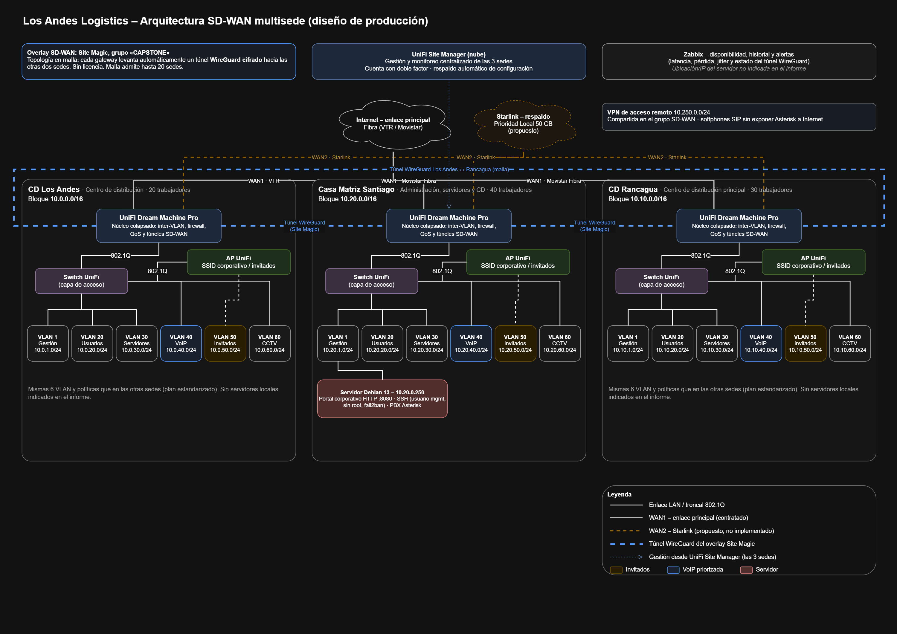

# Migración de interconexión GRE a una arquitectura SD-WAN
Proyecto de título (Capstone) — Ingeniería en Conectividad y Redes, Duoc UC, sede Plaza Norte, 2026.

**Integrantes:** Dorian Chávez · José Lobos

**Docente guía:** Claudio Hormazábal

## Caso: Los Andes Logistics

Empresa logística simulada con tres sedes: Los Andes, Santiago y Rancagua. Cada sede organiza su LAN con criterios distintos y la empresa depende del proveedor para hacer cambios en la WAN. Ante congestión o caída de un enlace pueden verse afectados la telefonía IP, el CCTV y los sistemas logísticos.

**Objetivo:** que las tres sedes compartan un criterio común de direccionamiento y segmentación, se administren desde una plataforma única (UniFi) y mantengan acceso a los servicios corporativos entre sedes.



## Componentes de la solución

| Área | Tecnología usada en el laboratorio |
|---|---|
| Gateways | Unifi Express 7 |
| Interconexión entre sedes | UniFi SD-WAN (túneles WireGuard entre gateways) |
| Acceso remoto | OpenVPN (pool 10.250.0.0/24) |
| Segmentación | 6 VLAN por sede: Gestión, Usuarios, Servidores, VoIP, Invitados, CCTV |
| Servicios de prueba | Servidor Debian con portal web (HTTP) y SSH |
| Monitoreo | Zabbix: disponibilidad, latencia, pérdida, handshake WireGuard, tráfico del túnel y jitter UDP (iPerf3) |

Detalle completo en [`diseno/plan-direccionamiento.md`](diseno/plan-direccionamiento.md).

## Estado del proyecto

| Ítem | Estado | Evidencia |
|---|---|---|
| Tres gateways integrados en el grupo SD-WAN | Implementado | `docs/fase-2-implementacion/evidencias-implementacion-sdwan.docx` |
| Conectividad entre sedes (ICMP, HTTP y SSH a servidor Debian) | Comprobado | Ídem |
| Asignación DHCP por VLAN | Comprobado | Ídem |
| Aislamiento de la red de invitados respecto del portal | Comprobado (Rancagua) | Ídem |
| Acceso remoto OpenVPN | Comprobado | `docs/fase-2-implementacion/informe-avance-fase-2.docx` |
| Monitoreo del túnel y jitter en Zabbix | Implementado | `docs/fase-2-implementacion/monitoreo-zabbix-sdwan.docx` |
| Conmutación ante falla de enlace WAN (failover) | Completado(Virtualizado) | — |
| Priorización de VoIP bajo congestión (QoS) | Completado(Limitación) | — |
| Llamada entre sedes con red congestionada | Completado(Limitación) | — |

## Estructura del repositorio

```
.
├── README.md
├── diseno/                         Topología y plan de direccionamiento
│   ├── topologia.png
│   ├── plan-direccionamiento.xlsx  (fuente de verdad)
│   └── plan-direccionamiento.md    (versión legible en GitHub)
├── docs/
│   ├── fase-1-definicion/          Propuesta inicial, guía y presentación
│   ├── fase-2-implementacion/      Avance, evidencias, monitoreo y presentación
│   └── fase-3-final/               Informe final y defensa (en preparación)
├── gestion/
│   └── flujo-caja-van.xlsx         Flujo de caja y VAN a 6 años
└── referencias/
    └── README.md                   Documentación oficial de fabricantes
```

## Documentos

| Fase | Documento | Archivo |
|---|---|---|
| 1 | Informe de definición del proyecto | [informe-fase-1.docx](docs/fase-1-definicion/informe-fase-1.docx) |
| 1 | Guía del estudiante — definición del proyecto | [guia-fase-1-definicion-proyecto.docx](docs/fase-1-definicion/guia-fase-1-definicion-proyecto.docx) |
| 1 | Presentación de la propuesta | [presentacion-fase-1.pptx](docs/fase-1-definicion/presentacion-fase-1.pptx) |
| 2 | Informe de avance | [informe-avance-fase-2.docx](docs/fase-2-implementacion/informe-avance-fase-2.docx) |
| 2 | Evidencias de implementación y validación SD-WAN | [evidencias-implementacion-sdwan.docx](docs/fase-2-implementacion/evidencias-implementacion-sdwan.docx) |
| 2 | Implementación y validación del monitoreo | [monitoreo-zabbix-sdwan.docx](docs/fase-2-implementacion/monitoreo-zabbix-sdwan.docx) |
| 2 | Guía del estudiante — informe final | [guia-fase-2-informe-final.docx](docs/fase-2-implementacion/guia-fase-2-informe-final.docx) |
| 2 | Presentación de avance | [presentacion-avance-fase-2.pptx](docs/fase-2-implementacion/presentacion-avance-fase-2.pptx) |
| — | Flujo de caja y VAN | [flujo-caja-van.xlsx](gestion/flujo-caja-van.xlsx) |

## Alcance y limitaciones

Todas las pruebas corresponden a un **entorno de laboratorio**, no a producción. Los resultados de conectividad no demuestran por sí solos alta disponibilidad ni calidad de voz; esas validaciones están listadas como pendientes.
